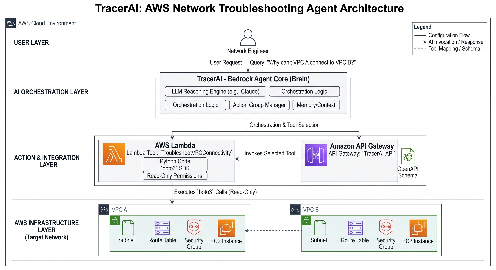

# TracerAI

**TracerAI** is an AI-powered AWS networking troubleshooting agent. It runs on **Amazon Bedrock Agents** and uses **AWS Lambda** tools (Python + `boto3`) to perform **read-only** inspection of live network infrastructure — VPCs, subnets, route tables, security groups, and Transit Gateway paths — then reasons about *why* connectivity is failing and explains it in plain language.

> ⚠️ **Proof of Concept** — under active development.

## What it does

Ask a natural-language question like *"Why can't VPC A connect to VPC B?"* and TracerAI reasons about the problem, calls the right read-only AWS APIs to gather the relevant configuration, and returns a diagnosis (e.g., a missing route, a blackhole, a security-group gap).

## Architecture

The PoC follows a clean layered flow:

1. **User Interface** — where a network engineer interacts with TracerAI (the Amazon Bedrock console, a custom web app, or a CLI).
2. **Bedrock Agent Core (TracerAI)** — the "brain." It receives the natural-language query, uses an LLM to reason about the problem, and decides which tools are needed to gather information.
3. **Action Group (AWS Lambda)** — the "hands." The Agent Core invokes a specific Lambda function (e.g., `TroubleshootVPCConnectivity`).
4. **Tools (Python / boto3)** — the Lambda contains the Python code, which uses the `boto3` SDK to execute **read-only** AWS API calls against the target infrastructure (e.g., `DescribeRouteTables`, `DescribeSecurityGroups`).
5. **API Gateway (Schema)** — defines the interface (the OpenAPI schema) between the Bedrock Agent and the Lambda tools, telling the Agent what functions are available and what parameters they require.

This matches the PoC stage: one reasoning agent, one example tool, one schema.

## Repository Layout

| Path | Purpose |
|------|---------|
| `lambdas/` | Python Lambda functions that act as agent tools (one folder per tool) |
| `lambdas/troubleshoot_vpc/` | Example tool — VPC connectivity checks (routes, SGs) |
| `schema/bedrock-agent-api.json` | OpenAPI schema defining the tools Bedrock can invoke |
| `docs/` | Documentation and architecture diagrams |

## Getting Started

_Setup and deployment documentation coming soon._ It will cover:

- Deploying the Lambda tool(s) in `lambdas/`
- Registering the Bedrock Agent **action group** against `schema/bedrock-agent-api.json`
- The IAM read-only permissions the Lambda execution role needs (`ec2:Describe*`, etc.)

## Security

All AWS API calls are **read-only** by design (describe/get/list). The Lambda execution role should be scoped to read-only networking permissions — TracerAI diagnoses, it never mutates infrastructure.

## License

TBD
